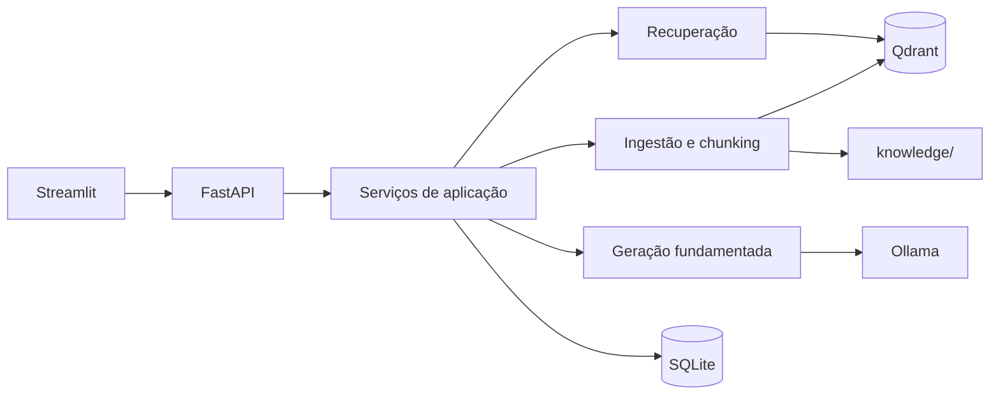

# Arquitetura inicial do NetOps AI

## Objetivo do MVP

O primeiro MVP deverá responder perguntas sobre DHCP, DNS e conectividade básica usando somente documentos autorizados em `knowledge/`. Cada resposta deverá carregar documento, página e trecho recuperado. Quando a recuperação não fornecer evidência suficiente, a aplicação retornará exatamente:

> Não encontrei essa informação na documentação disponível.

## Componentes

O fluxo mantém a interface separada do pipeline. Assim, um futuro frontend React poderá consumir a mesma API sem alterar a lógica de ingestão e resposta.

## Responsabilidades planejadas

- `api`: valida requisições, expõe respostas HTTP e não contém regras de RAG.
- `application`: coordena ingestão, busca, resposta e histórico.
- `domain`: define documentos, chunks, citações e contratos dos provedores.
- `infrastructure`: implementa PDF, Qdrant, Ollama e SQLite.
- `ui`: apresenta chat, upload e fontes, inicialmente com Streamlit.

Na Fase 1 foram implementados `api`, `core` e `schemas`. O incremento 2A adiciona `domain`, o leitor PDF em `infrastructure` e o chunking em `application`. O endpoint `POST /api/v1/documents/preview` permite inspecionar o resultado antes da indexação. Nenhum banco ou modelo de IA é chamado nessa prévia.

O incremento 2B adiciona `KnowledgeService`, o adaptador `LocalEmbeddings`, o catálogo `DocumentRegistry` e as rotas de indexação/listagem/busca. O serviço coordena diretamente `QdrantVectorStore` do LangChain e Qdrant Client; ainda não criamos uma abstração genérica de banco vetorial sem necessidade. A busca devolve fontes, não uma resposta gerada.

## Decisões da stack

### Python 3.12

É a versão presente no runtime desta sessão e possui suporte nas versões avaliadas de FastAPI, Pydantic, LangChain e Qdrant Client. Evitamos adotar a versão mais nova do Python antes de validar todas as bibliotecas de embeddings locais.

### FastAPI e Pydantic

FastAPI fornece contratos OpenAPI e validação de requisições. Pydantic Settings centraliza configurações sem guardar segredos no código. A API começa pequena, mas já permite separar a futura interface da lógica de negócio.

### LangChain

Já utilizado no incremento 2B: o adaptador de embeddings implementa `langchain_core.embeddings.Embeddings`, e `QdrantVectorStore` faz a inserção e a busca vetorial. Os contratos HTTP não expõem objetos LangChain. Testes de persistência injetam vetores determinísticos; um teste separado executa o modelo real.

### Qdrant

O incremento 2B usa o modo local persistente, adequado ao laboratório pequeno, com um único processo e acesso serializado. O cliente fecha no encerramento da API. Docker Compose e Qdrant servidor ficam para uma etapa posterior. Catálogo e base vetorial devem ser preservados juntos em um backup feito com a API parada.

### Ollama

Permanece como provedor local preferencial para a geração, ainda não implementada. O modelo de geração continua por escolher. Para embeddings já foi adotado MiniLM multilíngue quantizado em ONNX, executado em CPU; a decisão e sua avaliação inicial estão em [semantic-search.md](semantic-search.md).

### Streamlit

Entrará na Fase 3 como cliente da API, sem importar diretamente módulos de persistência ou RAG. Isso preserva a opção futura de React/TypeScript.

### SQLite

Já armazena registros de documentos e a configuração do índice. Conversas serão adicionadas posteriormente. Os estados `pending`, `indexed` e `failed` controlam a publicação dos trechos na busca. Não há transação distribuída: pontos de operações incompletas ficam ocultos e são substituídos quando o mesmo PDF é reenviado.

## Metadados mínimos por chunk

- identificador estável do documento e do chunk;
- hash do arquivo para detectar duplicatas;
- nome e origem autorizada;
- número da página;
- título ou seção, quando disponível;
- versão, fabricante e modelo, quando aplicáveis;
- data de ingestão e versão do pipeline.

## Compatibilidade com o exercício industrial

A arquitetura é independente do domínio e atende tanto redes quanto suporte industrial. O tema acadêmico, porém, pede explicitamente manutenção industrial. Antes da entrega, confirme com o professor se a troca para redes corporativas é aceita. Até essa confirmação, a opção de menor risco é manter um conjunto pequeno de documentos industriais de demonstração e usar os documentos de redes como extensão do portfólio.

## Marcos imediatos

1. Entregue: fundação executável com API, configuração e testes.
2. Entregue no incremento 2A: prévia de PDF preservando página e hash, com chunking testável.
3. Entregue no incremento 2B: embeddings e indexação incremental no Qdrant, com registro de documentos.
4. Entregue no incremento 2B: recuperação com fontes e avaliação sintética inicial; ampliação do conjunto de avaliação ainda pendente.
5. Geração via Ollama com recusa determinística quando faltar evidência.
6. Interface, upload e histórico persistente.

O diagrama acima representa o MVP planejado, não a implementação completa atual. Os detalhes executáveis estão em [ingestion-preview.md](ingestion-preview.md) e [semantic-search.md](semantic-search.md).

